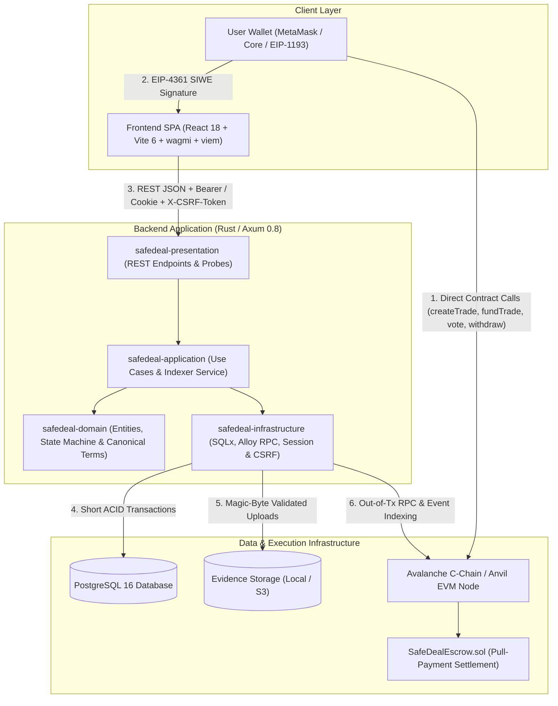
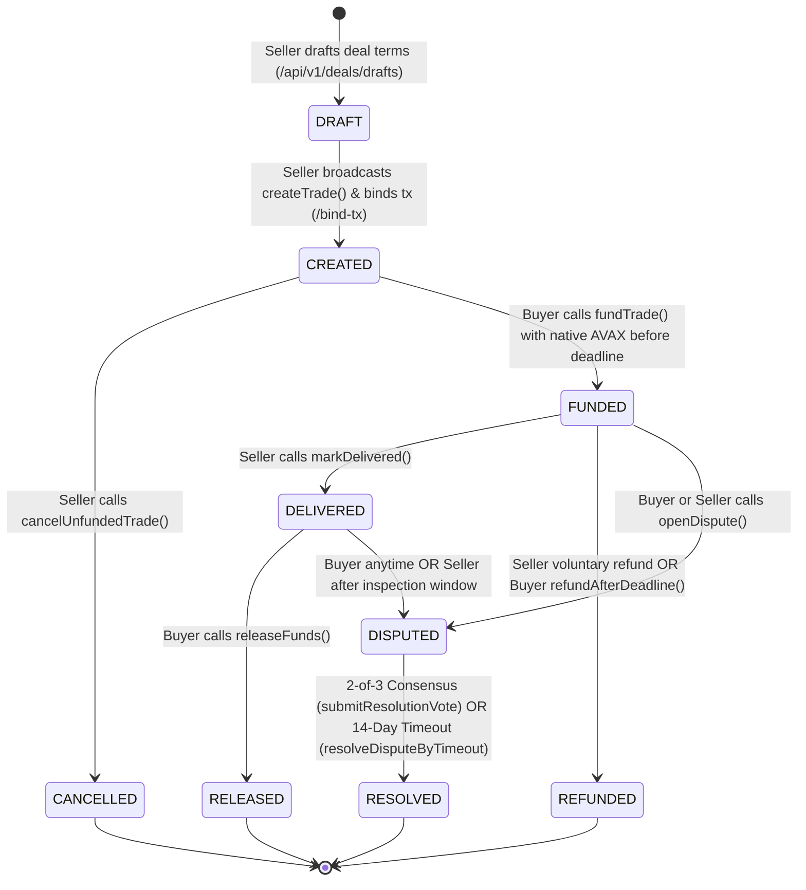

# SafeDeal

> Non-Custodial Peer-to-Peer Escrow on Avalanche C-Chain

- **Live Web App (Firebase Hosting)**: [https://avalanche-9b099.web.app](https://avalanche-9b099.web.app/)
- **Live Backend API (Railway)**: [https://safedeal-production.up.railway.app/api/v1/health/ready](https://safedeal-production.up.railway.app/api/v1/health/ready)
- **Avalanche Fuji C-Chain Contract (`43113`)**: [`0xF30E863b0Cfe8fBFE05E65c21878F8B621B3FE29`](https://testnet.snowtrace.io/address/0xF30E863b0Cfe8fBFE05E65c21878F8B621B3FE29)
- **GitHub Repository**: [https://github.com/hienpham0344/SafeDeal](https://github.com/hienpham0344/SafeDeal)

SafeDeal is a non-custodial P2P escrow platform for digital transactions, freelance deliverables, and OTC settlements on the Avalanche C-Chain (Fuji testnet & Anvil local). It pairs an immutable Solidity smart contract (`SafeDealEscrow.sol`) implementing pull-payment settlement and 2-of-3 dispute consensus with a Clean Architecture Rust backend (Axum, Tokio, SQLx, Alloy) and a React 18 SPA (TypeScript, Vite, Tailwind CSS, wagmi, viem).

By anchoring RFC 8785 canonical agreement hashes on-chain, enforcing deterministic state transitions, and providing a 14-day stalemate timeout fallback, SafeDeal guarantees that neither the backend service, deployer keys, nor unresponsive counterparties can alter terms, divert balances, or trap funds in escrow.

---

## 1. Core Capabilities & Security Guarantees

- **Non-Custodial Pull-Payment Escrow**: Native AVAX locks directly in `SafeDealEscrow.sol` with zero admin withdrawal, pause, or upgrade backdoors. All settlements credit internal `_claimableBalances` claimed via `withdraw()` (`nonReentrant`, Checks-Effects-Interactions), eliminating reentrancy and reverting-recipient DoS risks. Invariant fuzzing verifies `address(this).balance == totalLockedEscrow + totalClaimable`.
- **RFC 8785 Canonical Terms Anchoring**: Commercial terms (title, description, deadlines, inspection window, counterparties, amount in wei) are serialized via RFC 8785 Canonical JSON (`canonical_terms.rs` & `canonical-terms.ts`), hashed with SHA-256 (`termsHash`), and committed on-chain in `createTrade()`.
- **2-of-3 Dispute Consensus + 14-Day Stalemate Fallback**: Buyer, seller, and arbiter can propose/vote on resolution splits (`buyerAmount + sellerAmount == trade.amount`, zero arbiter fee). Any 2 matching votes settle immediately; after 14 days (`DISPUTE_TIMEOUT`), any participant can trigger `resolveDisputeByTimeout()` for an automatic 50/50 split.
- **SIWE (EIP-4361) + Cross-Site Session Resilience**: Passwordless wallet sign-in with single-use 5-minute PostgreSQL nonces, dual `HttpOnly` JWT cookies + Bearer token header support, Double-Submit CSRF (`X-CSRF-Token`), and peer-IP rate limiting.
- **Magic-Byte Validated Private Evidence**: Dispute attachments (`PNG`, `JPEG`, `PDF`, `TXT` up to 5 MB) are verified by binary magic bytes and restricted strictly to the deal's buyer, seller, and designated arbiter.
- **Non-Transactional RPC & Monotonic Indexer**: External Alloy JSON-RPC calls never run inside PostgreSQL transactions (`UnitOfWork::in_tx`). A background indexer polls and deduplicates chain logs on `(tx_hash, log_index)`.

---

## 2. System Architecture



### Trade Lifecycle State Machine



---

## 3. Technology Stack

| Layer | Technology | Version / Spec | Purpose |
|---|---|---|---|
| Smart Contracts | Solidity + Foundry + OpenZeppelin | `0.8.28` / `v5.x` | Non-custodial pull-payment escrow, unit/security/invariant suites |
| Backend Runtime | Rust + Axum + Tokio | `1.91+` / `0.8` / `1.x` | Clean Architecture workspace, REST API, background indexer |
| Persistence & EVM | SQLx + PostgreSQL + Alloy | `0.8` / `PG 16` / `1.7` | Async SQL migrations/queries and typed JSON-RPC codec |
| Crypto & OpenAPI | `k256` / `sha3` / `sha2` + `utoipa` | EIP-4361 / OpenAPI 3.0 | SIWE signature recovery, RFC 8785 SHA-256, `/v3/api-docs` |
| Frontend SPA | React + Vite + TypeScript + Tailwind | `18.3` / `6.x` / `5.7` / `3.4` | Strict-typed responsive UI, React Hook Form + Zod, TanStack Query v5 |
| Web3 & Testing | wagmi + viem + Vitest + Playwright | `2.14` / `2.23` / `3.0` / `1.50` | Wallet flows, contract reads/writes, unit & multi-viewport E2E tests |
| Cloud Deployment | Firebase Hosting + Railway | GitHub Actions CI/CD | Edge SPA hosting (`firebase.json`) & containerized Rust API + PG |

---

## 4. Repository Structure

```text
SafeDeal/
├── blockchain/              Foundry smart contracts, tests, and deployment scripts
│   ├── src/                 SafeDealEscrow.sol & ISafeDealEscrow.sol
│   ├── test/                Unit (SafeDealEscrow.t.sol), security, and invariant suites
│   ├── script/Deploy.s.sol  Deterministic contract deployment script
│   └── deployments/         Committed ABI and local deployment artifacts
│
├── backend/                 Clean Architecture Rust Cargo workspace
│   ├── crates/
│   │   ├── shared/          Error types, correlation IDs, timestamp & hex/wei helpers
│   │   ├── domain/          Entities, DealStatus state machine, RFC 8785 hasher, ports
│   │   ├── application/     Use cases (deals, disputes, arbitration, SIWE auth, indexer)
│   │   ├── infrastructure/  SQLx repos, Alloy RPC gateway, JWT/CSRF/rate-limit, storage
│   │   └── presentation/    Axum router (/api/v1/**), DTOs, error mapper, utoipa OpenAPI
│   ├── migrations/          SQLx PostgreSQL schema migrations
│   ├── tests/               Crate-DAG check, OpenAPI parity, Wiremock, PG & live Anvil tests
│   └── src/main.rs          Production binary entrypoint (safedeal-api)
│
├── frontend/                React 18 + Vite + TypeScript SPA
│   ├── src/
│   │   ├── app/             Providers, router, and error boundary
│   │   ├── components/      Landing, layout, wallet, and shared UI primitives
│   │   ├── config/          Runtime env validation, network, app, and brand configs
│   │   ├── contracts/       Typed SafeDealEscrow ABI definitions
│   │   ├── features/        Domain modules (authentication, deals, escrow, disputes, arbitration)
│   │   ├── pages/           Landing, HowItWorks, Support, Dashboard, CreateDeal, DealDetails, Dispute, Arbiter
│   │   ├── services/        HTTP client (Bearer/CSRF) & blockchain helpers
│   │   └── utils/           RFC 8785 canonical terms serializer, wei math, formatting
│   └── tests/               Vitest unit/integration tests and Playwright E2E suites
│
├── infra/                   Docker Compose stack (postgres, anvil, backend, frontend) & Railway guide
├── scripts/                 Developer automation (install, dev-*, deploy-*, verify, e2e-live, smoke-test)
├── docs/                    Architecture & operations docs (00–16), openapi.json, demo/, process/
├── firebase.json            Firebase Hosting SPA configuration
└── Makefile                 Shortcuts for install, dev, test, verify, and docker workflows
```

---

## 5. Quick Start (Local Development)

### Prerequisites
- **Rust `1.91+`** (`rustc`, `cargo`, `rustfmt`, `clippy`) — [rustup.rs](https://rustup.rs)
- **Node.js `22+` & npm**
- **Foundry** (`forge`, `anvil`, `cast`) — [getfoundry.sh](https://getfoundry.sh)
- **Docker & Docker Compose** (or local PostgreSQL 16)

### Option A: Native Development Stack (Recommended for fast iteration)

```bash
# 1. Initialize .env files from .env.example templates and install dependencies
INIT_ENV=1 bash scripts/install.sh

# 2. Start PostgreSQL 16 (Terminal 1) and local Anvil chain 31337 (Terminal 2)
bash scripts/dev-db.sh
bash scripts/dev-anvil.sh

# 3. Deploy SafeDealEscrow to local Anvil
export DEPLOYER_PRIVATE_KEY=<your-local-anvil-private-key>
bash scripts/deploy-local.sh
# Copy the printed contract address into backend/.env (ESCROW_CONTRACT_ADDRESS, BLOCKCHAIN_SYNC_ENABLED=true)
# and frontend/.env (VITE_ESCROW_CONTRACT_ADDRESS).

# 4. Start Rust Axum API on :8080 (Terminal 3) and Vite SPA on :5173 (Terminal 4)
bash scripts/dev-backend.sh
bash scripts/dev-frontend.sh

# 5. Run health & readiness smoke checks
bash scripts/smoke-test.sh
```

### Option B: Full Docker Compose Stack

```bash
cp .env.example .env
# Populate JWT_SECRET (>= 32 random chars, e.g. `openssl rand -hex 32`) in .env
docker compose --env-file .env -f infra/docker-compose.yml up --build
```

Services: Frontend `http://localhost:5173` · Backend `http://localhost:8080` (`/swagger-ui`) · Anvil `http://localhost:8545` · PostgreSQL `localhost:5432`. Reset volumes anytime with `bash scripts/reset-dev.sh`.

### Environment Configuration

SafeDeal uses four `.env.example` templates:
- **Root `.env.example`**: Unified variables for `infra/docker-compose.yml` and `scripts/dev-db.sh`.
- **`blockchain/.env.example`**: RPC endpoints (`LOCAL_RPC_URL`, `FUJI_RPC_URL`), chain IDs, and `DEPLOYER_PRIVATE_KEY` (used by `scripts/deploy-*.sh`).
- **`backend/.env.example`**: `APP_ENV`, `DATABASE_URL`, `JWT_SECRET`, SIWE/cookie/CORS settings, Alloy RPC & contract settings (used by `scripts/dev-backend.sh`).
- **`frontend/.env.example`**: `VITE_API_BASE_URL`, `VITE_CHAIN_ID`, `VITE_RPC_URL`, `VITE_ESCROW_CONTRACT_ADDRESS` (used by `scripts/dev-frontend.sh`).

See the full variable reference in [`docs/11-configuration-guide.md`](docs/11-configuration-guide.md).

---

## 6. Verification & Testing

Run the full monorepo verification gate (Foundry + Cargo + Frontend + Playwright):

```bash
make verify          # or: bash scripts/verify.sh
RUN_E2E=0 bash scripts/verify.sh   # fast gate without Playwright browser suite
```

| Layer | Command | Scope |
|---|---|---|
| Smart Contracts | `forge test --root blockchain -vvv` | Unit, reentrancy security, and stateful invariant fuzz suites |
| Backend Format & Lint | `cargo fmt --manifest-path backend/Cargo.toml --check && cargo clippy --manifest-path backend/Cargo.toml --workspace --all-targets -- -D warnings` | Rustfmt + zero-warning Clippy (`#![deny(unsafe_code)]`) |
| Backend Tests | `cargo test --manifest-path backend/Cargo.toml --workspace -- --test-threads=1` | Unit, crate-DAG, OpenAPI parity, Wiremock, PG 16 & live Anvil tests |
| Frontend Checks | `npm --prefix frontend run typecheck && npm --prefix frontend run lint && npm --prefix frontend test && npm --prefix frontend run build` | Strict TypeScript, ESLint, Vitest unit tests, production bundle |
| Browser E2E | `npm --prefix frontend run test:e2e` | Multi-viewport Playwright E2E suite |
| Live 3-Tier E2E | `bash scripts/e2e-live.sh` | Unmocked `Playwright -> Vite Preview -> safedeal-api -> Anvil` lifecycle |

---

## 7. Deployment

- **Avalanche Fuji Testnet (`43113`)**: Deploy via `bash scripts/deploy-fuji.sh` — full walkthrough in [`docs/13-fuji-setup.md`](docs/13-fuji-setup.md).
- **Backend (Railway)**: Multi-stage build from `backend/Dockerfile` (`backend/railway.json` healthcheck `/api/v1/health`) + managed PostgreSQL — walkthrough in [`docs/14-railway-setup.md`](docs/14-railway-setup.md).
- **Frontend (Firebase Hosting)**: Static SPA edge hosting via `firebase.json` and `.github/workflows/deploy-frontend.yml`.

---

## 8. Documentation Index

- **Architecture & Specifications**:
  - [`00-overview.md`](docs/00-overview.md) — Executive summary, trust boundaries, and problem framing
  - [`01-requirements.md`](docs/01-requirements.md) — Functional and non-functional requirements
  - [`02-architecture.md`](docs/02-architecture.md) — Clean Architecture crate graph and non-transactional RPC design
  - [`03-database-design.md`](docs/03-database-design.md) — PostgreSQL SQLx schema, constraints, and indexer deduplication
  - [`04-api-contracts.md`](docs/04-api-contracts.md) — REST endpoints, auth/CSRF headers, error envelopes, and [`openapi.json`](docs/openapi.json)
  - [`05-business-flows.md`](docs/05-business-flows.md) — End-to-end sequence diagrams
  - [`06-state-machines.md`](docs/06-state-machines.md) — On-chain and off-chain state transition matrices
  - [`07-smart-contract-design.md`](docs/07-smart-contract-design.md) — Pull-payment mechanics, 2-of-3 consensus, and invariants
  - [`08-security.md`](docs/08-security.md) — Threat model, SIWE, CSRF, and magic-byte evidence validation
  - [`09-deployment.md`](docs/09-deployment.md) — Docker Compose, Railway + Firebase topology, and CI/CD pipelines
  - [`10-testing-strategy.md`](docs/10-testing-strategy.md) — Foundry, Cargo, Vitest, and Playwright verification layers
- **Runbooks & Demo**:
  - [`11-configuration-guide.md`](docs/11-configuration-guide.md) — Complete environment variable reference
  - [`12-local-development.md`](docs/12-local-development.md) — Local setup walkthrough (Steps 1–8)
  - [`13-fuji-setup.md`](docs/13-fuji-setup.md) — Avalanche Fuji deployment walkthrough (Steps 9–13)
  - [`14-railway-setup.md`](docs/14-railway-setup.md) — Railway & Firebase production setup (Steps 14–19)
  - [`15-troubleshooting.md`](docs/15-troubleshooting.md) — Common diagnostics and fixes
  - [`16-hackathon-submission.md`](docs/16-hackathon-submission.md) — Hackathon submission dossier & [`docs/demo/`](docs/demo/)

---

## 9. License

SafeDeal is open-source software licensed under the [MIT License](backend/Cargo.toml).
