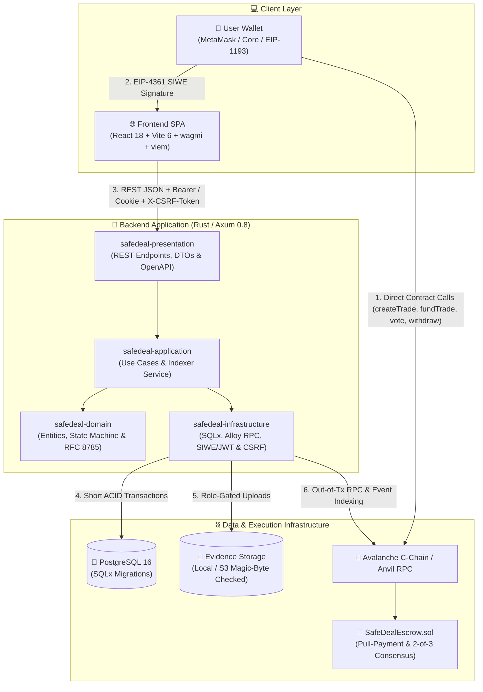
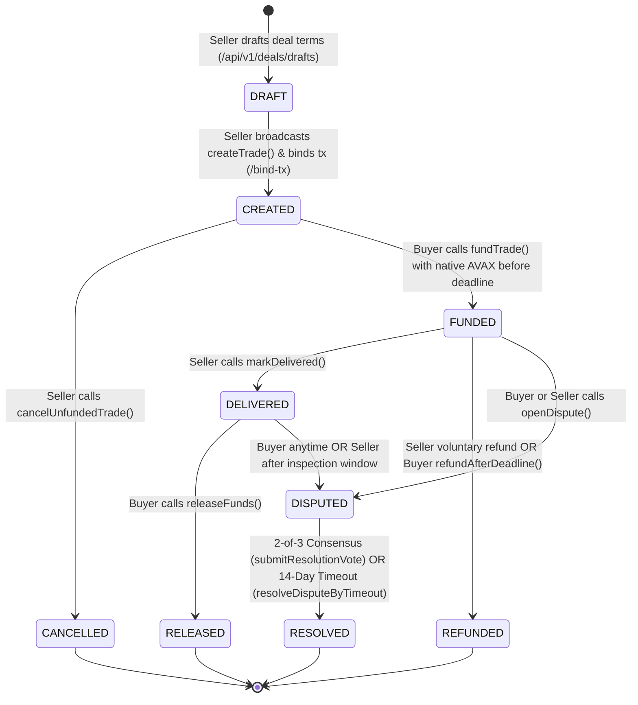

<div align="center">

# 🛡️ SafeDeal: Non-Custodial P2P Escrow on Avalanche C-Chain
### Pull-Payment Settlement, 2-of-3 Dispute Consensus, RFC 8785 Terms Anchoring & Clean Architecture Rust API

**Trust-minimized peer-to-peer digital commerce without custodial middlemen or permanently frozen funds.**<br/>
*Engineered with Solidity 0.8.28 (Foundry), Rust 1.91+ (Axum 0.8 • Tokio • SQLx • Alloy), and React 18 (Vite 6 • TypeScript • wagmi • viem).*

[](https://avalanche-9b099.web.app/)
[](https://safedeal-production.up.railway.app/api/v1/health/ready)
[](https://testnet.snowtrace.io/address/0xF30E863b0Cfe8fBFE05E65c21878F8B621B3FE29)
[](https://testnet.snowtrace.io/address/0xF30E863b0Cfe8fBFE05E65c21878F8B621B3FE29)
[-purple.svg?style=flat-square)](blockchain/)
[](backend/)
[](frontend/)
[](docs/08-security.md)
[](docs/07-smart-contract-design.md)
[](docs/openapi.json)
[-brightgreen.svg?style=flat-square)](blockchain/test/)
[](frontend/tests/)
[](backend/Cargo.toml)

<br/>

<p align="center">
  <a href="https://avalanche-9b099.web.app/"><b>Live Demo</b></a> •
  <a href="https://testnet.snowtrace.io/address/0xF30E863b0Cfe8fBFE05E65c21878F8B621B3FE29"><b>Snowtrace Contract</b></a> •
  <a href="#-what-is-safedeal"><b>What is SafeDeal?</b></a> •
  <a href="#-system-architecture"><b>Architecture</b></a> •
  <a href="#-technology-stack"><b>Tech Stack</b></a> •
  <a href="#-repository-structure"><b>Repo Structure</b></a> •
  <a href="#-quick-start--setup-guide"><b>Quick Start</b></a> •
  <a href="#-verification--quality-gates"><b>Verification</b></a> •
  <a href="#-production-deployment"><b>Deployment</b></a> •
  <a href="#-documentation-index"><b>Docs Index</b></a>
</p>

</div>

---

## 💡 What is SafeDeal?

Direct peer-to-peer digital commerce suffers from an asymmetric trust gap: paying upfront exposes buyers to non-delivery, delivering upfront exposes sellers to payment default, and centralized escrow platforms introduce custodial freeze risks and high fees.

**SafeDeal is a non-custodial Web2.5 P2P escrow platform on the Avalanche C-Chain that pairs deterministic on-chain AVAX custody with cryptographically anchored off-chain agreements.**

SafeDeal guarantees mathematical asset safety and operational resilience across every layer:

- 🔒 **Non-Custodial Pull-Payment Escrow**: Native AVAX deposits lock directly inside [`SafeDealEscrow.sol`](blockchain/src/SafeDealEscrow.sol) with zero admin withdrawal, pause, or upgrade backdoors. All settlements credit internal `_claimableBalances` withdrawn via `withdraw()` (`nonReentrant`, Checks-Effects-Interactions), eliminating reentrancy and reverting-recipient DoS vectors.
- 📜 **RFC 8785 Canonical Terms Anchoring**: Commercial terms (title, description, deadlines, inspection window, counterparties, and wei amount) are deterministically serialized via RFC 8785 Canonical JSON ([`canonical_terms.rs`](backend/crates/domain/src/canonical_terms.rs) & [`canonical-terms.ts`](frontend/src/utils/canonical-terms.ts)), hashed with SHA-256 (`termsHash`), and committed on-chain in `createTrade()`.
- ⚖️ **2-of-3 Dispute Consensus + 14-Day Stalemate Fallback**: Buyer, seller, and arbiter can propose or vote on resolution splits (`buyerAmount + sellerAmount == trade.amount`, zero arbiter fee). Any 2 matching votes settle immediately; after 14 days (`DISPUTE_TIMEOUT`), any participant can trigger `resolveDisputeByTimeout()` for an automatic 50/50 split.
- 🔑 **SIWE (EIP-4361) + Cross-Site Session Resilience**: Passwordless wallet sign-in with atomic single-use 5-minute PostgreSQL nonces, dual `HttpOnly` HS256 JWT cookies + Bearer token support, Double-Submit CSRF (`X-CSRF-Token`), and peer-IP rate limiting.
- 🗂️ **Magic-Byte Validated Private Evidence**: Dispute attachments (`PNG`, `JPEG`, `PDF`, `TXT` up to 5 MB) are verified by binary magic bytes and restricted strictly to the deal's buyer, seller, and designated arbiter.
- ⚡ **Non-Transactional RPC & Monotonic Indexer**: External Alloy JSON-RPC calls never execute inside PostgreSQL transactions (`UnitOfWork::in_tx`). A background indexer polls and deduplicates chain logs on `(tx_hash, log_index)`.

---

## 🏛️ System Architecture



### Trade Lifecycle State Machine



---

## 🛠️ Technology Stack

| Layer | Technology | Version / Spec | Purpose |
| :--- | :--- | :--- | :--- |
| **Smart Contracts** | Solidity + Foundry + OpenZeppelin | `0.8.28` / `v5.x` | Non-custodial pull-payment escrow, unit/security/invariant suites |
| **Backend Runtime** | Rust + Axum + Tokio | `1.91+` / `0.8` / `1.x` | Clean Architecture workspace, REST API, background indexer |
| **Persistence & EVM** | SQLx + PostgreSQL + Alloy | `0.8` / `PG 16` / `1.7` | Async SQL migrations/queries and typed `sol!` JSON-RPC codec |
| **Crypto & OpenAPI** | `k256` / `sha3` / `sha2` + `utoipa` | EIP-4361 / OpenAPI 3.0 | SIWE signature recovery, RFC 8785 SHA-256, `/v3/api-docs` |
| **Frontend SPA** | React + Vite + TypeScript + Tailwind | `18.3` / `6.x` / `5.7` / `3.4` | Strict-typed responsive UI, React Hook Form + Zod, TanStack Query v5 |
| **Web3 & Testing** | wagmi + viem + Vitest + Playwright | `2.14` / `2.23` / `3.0` / `1.50` | Wallet flows, contract reads/writes, unit & multi-viewport E2E tests |
| **Cloud Deployment** | Firebase Hosting + Railway | GitHub Actions CI/CD | Edge SPA hosting ([`firebase.json`](firebase.json)) & containerized Rust API + PG |

---

## 📁 Repository Structure

```text
SafeDeal/
├── blockchain/              Foundry smart contracts, tests, and deployment scripts
│   ├── src/                 SafeDealEscrow.sol & ISafeDealEscrow.sol
│   ├── test/                Unit (SafeDealEscrow.t.sol), security, and invariant suites
│   ├── script/Deploy.s.sol  Deterministic contract deployment script
│   └── deployments/         Committed ABI and local deployment artifacts
│
├── backend/                 Clean Architecture Rust Cargo workspace
│   ├── crates/
│   │   ├── shared/          Error types, correlation IDs, timestamp & hex/wei helpers
│   │   ├── domain/          Entities, DealStatus state machine, RFC 8785 hasher, ports
│   │   ├── application/     Use cases (deals, disputes, arbitration, SIWE auth, indexer)
│   │   ├── infrastructure/  SQLx repos, Alloy RPC gateway, JWT/CSRF/rate-limit, storage
│   │   └── presentation/    Axum router (/api/v1/**), DTOs, error mapper, utoipa OpenAPI
│   ├── migrations/          SQLx PostgreSQL schema migrations
│   ├── tests/               Crate-DAG check, OpenAPI parity, Wiremock, PG & live Anvil tests
│   └── src/main.rs          Production binary entrypoint (safedeal-api)
│
├── frontend/                React 18 + Vite + TypeScript SPA
│   ├── src/
│   │   ├── app/             Providers, router, and error boundary
│   │   ├── components/      Landing, layout, wallet, and shared UI primitives
│   │   ├── config/          Runtime env validation, network, app, and brand configs
│   │   ├── contracts/       Typed SafeDealEscrow ABI definitions
│   │   ├── features/        Domain modules (authentication, deals, escrow, disputes, arbitration)
│   │   ├── pages/           Landing, HowItWorks, Support, Dashboard, CreateDeal, DealDetails, Dispute, Arbiter
│   │   ├── services/        HTTP client (Bearer/CSRF) & blockchain helpers
│   │   └── utils/           RFC 8785 canonical terms serializer, wei math, formatting
│   └── tests/               Vitest unit/integration tests and Playwright E2E suites
│
├── infra/                   Docker Compose stack (postgres, anvil, backend, frontend) & Railway guide
├── scripts/                 Developer automation (install, dev-*, deploy-*, verify, e2e-live, smoke-test)
├── docs/                    Architecture & operations docs (00–16), openapi.json, demo/, process/
├── firebase.json            Firebase Hosting SPA configuration
└── Makefile                 Shortcuts for install, dev, test, verify, and docker workflows
```

---

## ⚡ Quick Start & Setup Guide

### 1. Prerequisites

| Requirement | Minimum Version | Verification Command | Purpose |
| :--- | :--- | :--- | :--- |
| **Rust Toolchain** | `1.91+` | `rustc --version && cargo --version` | Compiling `safedeal-api` & workspace crates ([rustup.rs](https://rustup.rs)) |
| **Node.js / npm** | `22+` | `node -v && npm -v` | Building Vite SPA, Vitest, and Playwright suites |
| **Foundry** | Latest | `forge --version && anvil --version` | Solidity compilation, fuzzing, and local EVM node ([getfoundry.sh](https://getfoundry.sh)) |
| **Docker / PostgreSQL** | PG `16` | `docker compose version` | Running PostgreSQL 16 or full containerized stack |

> [!TIP]
> **Fast Native Iteration:**
> For day-to-day coding, use the native scripts (`scripts/dev-*.sh`) instead of rebuilding the full Docker image (which compiles Rust in release mode with LTO).

### 2. Option A: Native Development Stack (Recommended)

```bash
# 1. Initialize .env files from .env.example templates and install dependencies
INIT_ENV=1 bash scripts/install.sh

# 2. Start PostgreSQL 16 (Terminal 1) and local Anvil chain 31337 (Terminal 2)
bash scripts/dev-db.sh
bash scripts/dev-anvil.sh

# 3. Deploy SafeDealEscrow to local Anvil
export DEPLOYER_PRIVATE_KEY=<your-local-anvil-private-key>
bash scripts/deploy-local.sh
# Copy the printed contract address into backend/.env (ESCROW_CONTRACT_ADDRESS, BLOCKCHAIN_SYNC_ENABLED=true)
# and frontend/.env (VITE_ESCROW_CONTRACT_ADDRESS).

# 4. Start Rust Axum API on :8080 (Terminal 3) and Vite SPA on :5173 (Terminal 4)
bash scripts/dev-backend.sh
bash scripts/dev-frontend.sh

# 5. Run health & readiness smoke checks
bash scripts/smoke-test.sh
```

### 3. Option B: Full Docker Compose Stack

```bash
cp .env.example .env
# Populate JWT_SECRET (>= 32 random chars, e.g. `openssl rand -hex 32`) in .env
docker compose --env-file .env -f infra/docker-compose.yml up --build
```

Services: Frontend `http://localhost:5173` • Backend `http://localhost:8080` (`/swagger-ui`) • Anvil `http://localhost:8545` • PostgreSQL `localhost:5432`. Reset volumes anytime with `bash scripts/reset-dev.sh`.

> [!NOTE]
> **Environment Configuration Templates:**
> SafeDeal uses four `.env.example` templates: root [`.env.example`](.env.example) (Docker Compose), [`blockchain/.env.example`](blockchain/.env.example), [`backend/.env.example`](backend/.env.example), and [`frontend/.env.example`](frontend/.env.example). See the full variable catalog in [`docs/11-configuration-guide.md`](docs/11-configuration-guide.md).

---

## 🧪 Verification & Quality Gates

Run the full monorepo verification gate across contracts, Rust crates, frontend, and Playwright E2E:

```bash
make verify                        # Full gate (Foundry + Cargo + Frontend + Playwright)
RUN_E2E=0 bash scripts/verify.sh   # Fast gate skipping browser E2E
```

| Layer | Command | Verification Scope |
| :--- | :--- | :--- |
| **Smart Contracts** | `forge test --root blockchain -vvv` | Unit, reentrancy security, and `64 x 2048` stateful invariant fuzz suites |
| **Backend Format & Lint** | `cargo fmt --manifest-path backend/Cargo.toml --check && cargo clippy --manifest-path backend/Cargo.toml --workspace --all-targets -- -D warnings` | Rustfmt + zero-warning Clippy (`#![deny(unsafe_code)]`) |
| **Backend Tests** | `cargo test --manifest-path backend/Cargo.toml --workspace -- --test-threads=1` | Unit, crate-DAG, OpenAPI parity, Wiremock, PG 16 & live Anvil tests |
| **Frontend Checks** | `npm --prefix frontend run typecheck && npm --prefix frontend run lint && npm --prefix frontend test && npm --prefix frontend run build` | Strict TypeScript, ESLint, Vitest unit tests, production bundle |
| **Browser E2E** | `npm --prefix frontend run test:e2e` | Multi-viewport Playwright E2E suite (`1440x900`, `768x1024`, `390x844`) |
| **Live 3-Tier E2E** | `bash scripts/e2e-live.sh` | Unmocked `Playwright -> Vite Preview -> safedeal-api -> Anvil` lifecycle |

---

## ☁️ Production Deployment

| Component | Target Platform | Live URL / Artifact | Runbook |
| :--- | :--- | :--- | :--- |
| **Frontend SPA** | Firebase Hosting CDN | [https://avalanche-9b099.web.app](https://avalanche-9b099.web.app/) | [`.github/workflows/deploy-frontend.yml`](.github/workflows/deploy-frontend.yml) |
| **Backend API** | Railway (`backend/Dockerfile`) | [https://safedeal-production.up.railway.app/api/v1/health/ready](https://safedeal-production.up.railway.app/api/v1/health/ready) | [`docs/14-railway-setup.md`](docs/14-railway-setup.md) |
| **Smart Contract** | Avalanche Fuji C-Chain (`43113`) | [`0xF30E863b0Cfe8fBFE05E65c21878F8B621B3FE29`](https://testnet.snowtrace.io/address/0xF30E863b0Cfe8fBFE05E65c21878F8B621B3FE29) | [`docs/13-fuji-setup.md`](docs/13-fuji-setup.md) |

---

## 📚 Documentation Index

| Document | Focus Area |
| :--- | :--- |
| [`docs/00-overview.md`](docs/00-overview.md) | Executive summary, trust boundaries, and problem framing |
| [`docs/01-requirements.md`](docs/01-requirements.md) | Functional and non-functional requirements |
| [`docs/02-architecture.md`](docs/02-architecture.md) | Clean Architecture crate graph and non-transactional RPC design |
| [`docs/03-database-design.md`](docs/03-database-design.md) | PostgreSQL SQLx schema, constraints, and indexer deduplication |
| [`docs/04-api-contracts.md`](docs/04-api-contracts.md) | REST endpoints, auth/CSRF headers, error envelopes, and [`openapi.json`](docs/openapi.json) |
| [`docs/05-business-flows.md`](docs/05-business-flows.md) | End-to-end sequence diagrams |
| [`docs/06-state-machines.md`](docs/06-state-machines.md) | On-chain and off-chain state transition matrices |
| [`docs/07-smart-contract-design.md`](docs/07-smart-contract-design.md) | Pull-payment mechanics, 2-of-3 consensus, and invariants |
| [`docs/08-security.md`](docs/08-security.md) | Threat model, SIWE, CSRF, and magic-byte evidence validation |
| [`docs/09-deployment.md`](docs/09-deployment.md) | Docker Compose, Railway + Firebase topology, and CI/CD pipelines |
| [`docs/10-testing-strategy.md`](docs/10-testing-strategy.md) | Foundry, Cargo, Vitest, and Playwright verification layers |
| [`docs/11-configuration-guide.md`](docs/11-configuration-guide.md) | Complete environment variable reference |
| [`docs/12-local-development.md`](docs/12-local-development.md) | Local setup walkthrough (Steps 1–8) |
| [`docs/13-fuji-setup.md`](docs/13-fuji-setup.md) | Avalanche Fuji deployment walkthrough (Steps 9–13) |
| [`docs/14-railway-setup.md`](docs/14-railway-setup.md) | Railway & Firebase production setup (Steps 14–19) |
| [`docs/15-troubleshooting.md`](docs/15-troubleshooting.md) | Common diagnostics and fixes |
| [`docs/16-hackathon-submission.md`](docs/16-hackathon-submission.md) | UNIHACK 2026 submission dossier & [`docs/demo/`](docs/demo/) pitch materials |

---

## 📄 License

SafeDeal is open-source software licensed under the [MIT License](backend/Cargo.toml).
