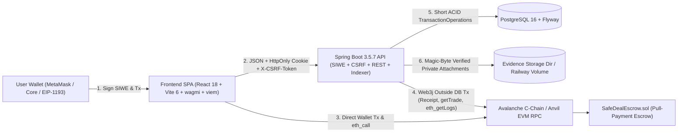
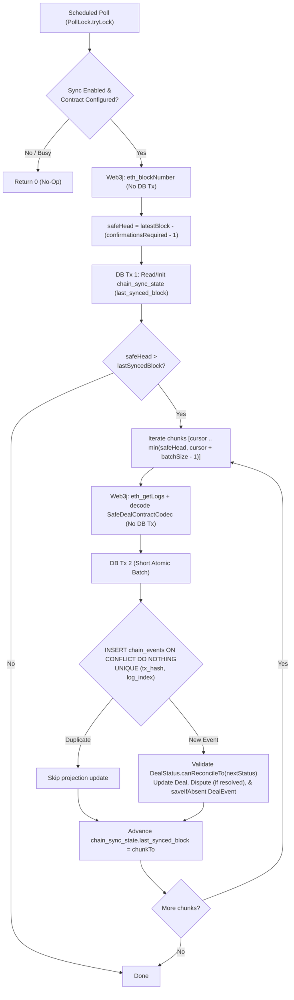

# System Architecture & Synchronization Design

## 1. High-Level Clean Architecture

SafeDeal strictly decouples irreversible EVM asset custody (`blockchain/SafeDealEscrow.sol`) from rich commercial metadata, authentication, indexing, and dispute evidence storage (`backend/` Clean Modular Monolith + `PostgreSQL` + `frontend/`).

## 2. Backend Module Boundaries (`com.safedeal`)

Enforced automatically during every test run by [`ModuleBoundaryArchTest`](../backend/src/test/java/com/safedeal/ModuleBoundaryArchTest.java):

| Layer | Package | Permitted Dependencies | Responsibilities |
|---|---|---|---|
| **Domain** | `com.safedeal.domain.*` | Standard JDK + `shared` | Entities (`Deal`, `Dispute`, `DealStatus`), `CanonicalTermsHasher` (RFC 8785), and 13 port interfaces (`BlockchainGateway`, `DatabaseReadinessPort`, `EvidenceStoragePort`, repositories). Zero imports of Spring, JPA, or Web3j. |
| **Application** | `com.safedeal.application.*` | `domain`, `shared`, `TransactionOperations` | Use cases (`CreateDealDraftUseCase`, `BindDealTransactionUseCase`, `SyncDealUseCase`, `QueryDealsUseCase`, `DisputeUseCase`, `ArbitrationUseCase`, `SiweAuthService`, `BlockchainEventIndexerService`). |
| **Infrastructure** | `com.safedeal.infrastructure.*` | `domain`, `application`, frameworks | JPA/Flyway repositories, `JdbcDatabaseReadinessAdapter`, `Web3jBlockchainGateway`, `SafeDealContractCodec`, `Web3jSignatureVerifier`, `JwtSessionService`, `DoubleSubmitCsrfFilter`, `AuthRateLimitFilter`, `LocalEvidenceStorageAdapter`. |
| **Presentation** | `com.safedeal.presentation.*` | `application`, `domain`, `shared` | `/api/v1/**` REST controllers (`AuthController`, `DealController`, `DisputeController`, `ArbitrationController`, `HealthController`), SpringDoc DTOs, `ApiDtoMapper`, `GlobalExceptionHandler`. |

## 3. Non-Transactional RPC & HikariCP Isolation

Database connections are **never** held while waiting on external Avalanche RPC responses:
1. Phase 1 (`TransactionOperations`): Short DB read verifies authorization and preconditions.
2. Phase 2 (no active transaction): `Web3jBlockchainGateway` executes `eth_getTransactionReceipt`, `getTrade`, or `eth_getLogs` bounded by `BLOCKCHAIN_RPC_TIMEOUT_MS`.
3. Phase 3 (`TransactionOperations`): Short ACID write persists reconciled `deals`, idempotent `chain_events`, `deal_events`, `disputes`, and `audit_logs`.

## 4. Blockchain Event Synchronization & Reconciliation Flow

Background indexing (`BlockchainEventIndexerService`) complements immediate user-triggered `POST /api/v1/deals/{tradeId}/sync` calls so off-chain views catch up automatically even if the user closes their browser immediately after broadcasting a transaction.

## 5. Frontend Architecture Summary (`frontend/src/`)

- `config/` — `env.ts` (Zod-safe parsing of `VITE_*` variables), `brand.config.ts` (editorial Foldcraft copy & navigation), `app.config.ts` (`sessionStorage`/`localStorage` prefixes, limits), `network.config.ts` (Fuji & Anvil wagmi chains), `routes.ts`.
- `features/` — `authentication` (SIWE + HttpOnly cookie modal/context), `deals` (API hooks + `useCreateDraftPersistence` reload recovery + `usePendingTransactions`), `disputes`, `arbitration`, `escrow` (`useEscrowActions` enforcing `chainId` & configured contract address prior to wallet signing).
- `contracts/SafeDealEscrow.ts` — Strongly typed ABI matching `ISafeDealEscrow.sol`.
- **OpenAPI Contract Verification**: [`OpenApiContractVerificationTest`](../backend/src/test/java/com/safedeal/OpenApiContractVerificationTest.java) enforces exact schema parity between SpringDoc `/v3/api-docs` and the committed [`docs/openapi.json`](./openapi.json).
