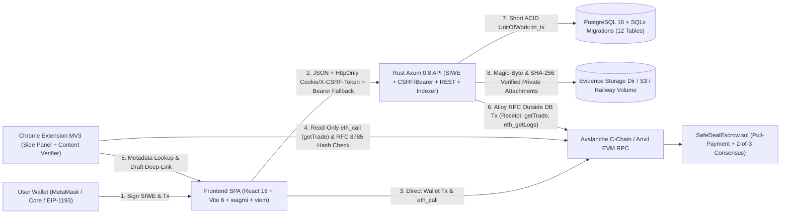
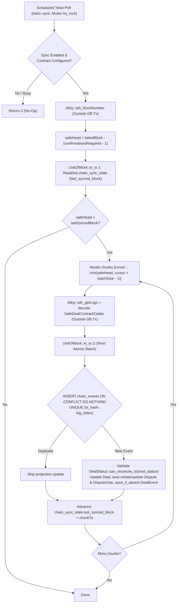

# System Architecture & Synchronization Design

## 1. High-Level Clean Architecture

SafeDeal strictly decouples irreversible EVM asset custody (`blockchain/src/SafeDealEscrow.sol`) from rich commercial metadata, authentication, indexing, dispute evidence storage (`backend/` 5-crate Rust Clean Architecture workspace + `PostgreSQL 16` + `frontend/`), and in-browser verification (`extension/` Manifest V3 Chrome Extension).

## 2. Backend Module Boundaries (5-Crate Rust Workspace)

Enforced by the Cargo workspace crate graph (`backend/Cargo.toml`) and verified on every test run by [`architecture_dag.rs`](../backend/tests/architecture_dag.rs):

| Layer | Cargo Crate (`Path`) | Permitted Dependencies | Responsibilities |
|---|---|---|---|
| **Shared** | `safedeal-shared` (`crates/shared`) | Pure utility crates (`serde`, `thiserror`, `chrono`, `uuid`) | Cross-cutting primitives, correlation IDs, Ethereum format validation (`EthFormatValidator`), and common value types. Zero framework or I/O dependencies. |
| **Domain** | `safedeal-domain` (`crates/domain`) | `safedeal-shared` + pure crates (`serde`, `sha2`, …) | Entities (`Deal`, `Dispute`, `DisputeVote`, `DealStatus`, `DisputeStatus`), `CanonicalTermsHasher` (RFC 8785), and port traits in `ports.rs` (`BlockchainGateway`, `DatabaseReadinessPort`, `EvidenceStoragePort`, `UnitOfWork`, repositories). Zero imports of `sqlx`, `axum`, `tower`, `reqwest`, or `alloy-provider`. |
| **Application** | `safedeal-application` (`crates/application`) | `safedeal-domain`, `safedeal-shared` | Use cases (`CreateDealDraftUseCase`, `BindDealTransactionUseCase`, `SyncDealUseCase`, `QueryDealsUseCase`, `DisputeUseCase`, `ArbitrationUseCase`, `CleanupOrphanDraftsUseCase`, `SiweAuthService`, `BlockchainEventIndexerService`) orchestrating short `UnitOfWork::in_tx` boundaries. Zero imports of `sqlx`, `axum`, `tower`, `reqwest`, or `alloy-provider`. |
| **Infrastructure** | `safedeal-infrastructure` (`crates/infrastructure`) | `safedeal-domain`, `safedeal-application`, `safedeal-shared`, frameworks | SQLx PostgreSQL repositories & `PgUnitOfWork` (`persistence/`), `PgDatabaseReadinessAdapter`, `AlloyBlockchainGateway`, `SafeDealContractCodec`, `K256SignatureVerifier`, `JwtSessionService`, `csrf_protection_middleware`, `AuthRateLimitState`, `LocalEvidenceStorageAdapter` / `S3EvidenceStorage`, and `AppConfig::validate`. |
| **Presentation** | `safedeal-presentation` (`crates/presentation`) & binary `safedeal-api` | `safedeal-application`, `safedeal-domain`, `safedeal-shared` | `/api/v1/**` Axum 0.8 route handlers (`routes/{auth,deals,disputes,arbitration,health}.rs`), `utoipa` OpenAPI DTOs (`dto.rs`), `mapper.rs`, `ApiError` (`error.rs`), and router wiring (`router.rs`). |

## 3. Non-Transactional RPC & Connection Pool Isolation

Database connections from `sqlx::PgPool` are **never** held while waiting on external Avalanche JSON-RPC responses:
1. **Phase 1 (`UnitOfWork::in_tx`)**: Short PostgreSQL read verifies caller authorization, role ACLs, and preconditions.
2. **Phase 2 (outside any DB transaction)**: `AlloyBlockchainGateway` executes `eth_getTransactionReceipt`, `getTrade`, `getDisputeVotes`, or `eth_getLogs` bounded by `BLOCKCHAIN_RPC_TIMEOUT_MS`.
3. **Phase 3 (`UnitOfWork::in_tx`)**: Short ACID transaction persists reconciled `deals`, idempotent `chain_events`, `deal_events`, `disputes` (including auto-indexed fallback rows if opened directly on-chain), `dispute_votes`, and `audit_logs`.

## 4. Blockchain Event Synchronization & Reconciliation Flow

Background indexing (`BlockchainEventIndexerService`, guarded by a single-flight `tokio::sync::Mutex` poll lock and SQLx row/advisory concurrency controls) complements immediate user-triggered `POST /api/v1/deals/{tradeId}/sync` calls so off-chain views catch up automatically even if the user closes their browser immediately after broadcasting a transaction.

## 5. Frontend (`frontend/src/`) & Chrome Extension (`extension/`) Architecture

- **Frontend (`frontend/src/`)**:
  - `config/` — `env.ts` (Zod-safe parsing of `VITE_*` variables), `brand.config.ts` (editorial Foldcraft copy & navigation), `app.config.ts` (`sessionStorage`/`localStorage` prefixes, limits), `network.config.ts` (Avalanche Fuji & Anvil wagmi chains), `routes.ts`.
  - `features/` — `authentication` (SIWE + dual-mode cookie/Bearer + EIP-1193 `4902` `wallet_addEthereumChain` Fuji auto-onboarding), `deals` (API hooks + 1-click SEApp UIT templates + `useCreateDraftPersistence` reload recovery + `usePendingTransactions`), `disputes` (authenticated Blob evidence download + 2-of-3 consensus voting & 14-day timeout trigger), `arbitration`, `escrow` (`useEscrowActions`).
  - `contracts/SafeDealEscrow.ts` — Strongly typed ABI matching `ISafeDealEscrow.sol` (`submitResolutionVote`, `resolveDisputeByTimeout`, `getDisputeVotes`).
- **Chrome Extension (`extension/`, Manifest V3)**:
  - `service-worker.js` — Ephemeral MV3 background controller enabling `openPanelOnActionClick: true`, context-menu draft capture (`chrome.contextMenus` + `chrome.storage.local`), `chrome.alarms` polling, and message routing.
  - `shared/canonical-terms.js` & `shared/rpc-client.js` — Bit-identical RFC 8785 canonical JSON SHA-256 `termsHash` generator and read-only Avalanche Fuji `eth_call` (`getTrade`, `claimableBalance`, `getDisputeVotes`) verifier requiring zero wallet sign-in.
  - `sidepanel/` & `content/deal-verifier.js` — Side Panel 3-tab command center and `requestAnimationFrame` + `scheduler.yield()` batched Shadow DOM link verifier.
- **OpenAPI Contract Verification**: [`openapi_contract.rs`](../backend/tests/openapi_contract.rs) enforces exact schema parity between the `utoipa`-generated `/v3/api-docs` and the committed [`docs/openapi.json`](./openapi.json).
