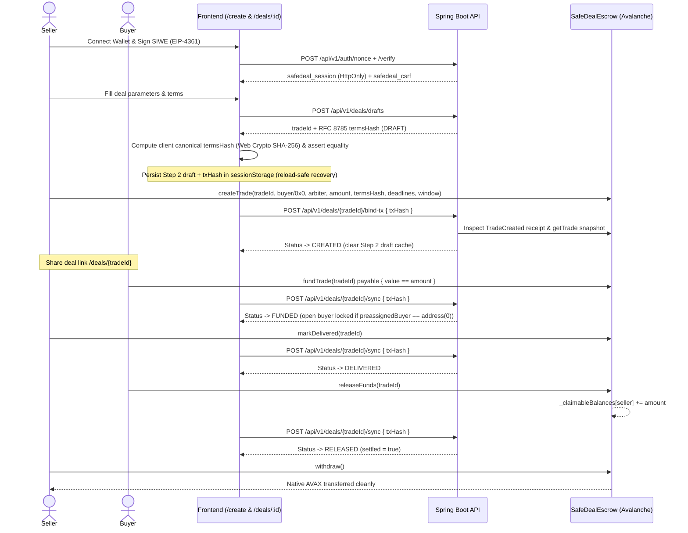

# Core Business Flows & Sequences

## 1. Cooperative Trade Flow (Buyer, Seller, Frontend, API & SafeDealEscrow)



## 2. Dispute, Magic-Byte Evidence & Split Arbitration Sequence

```mermaid
sequenceDiagram
    actor Seller
    actor Buyer
    actor Arbiter
    participant FE as Frontend (/deals/:id, /disputes/:id, /arbiter)
    participant API as Spring Boot API
    participant SC as SafeDealEscrow

    Note over Buyer,SC: Deal is FUNDED (either party) or DELIVERED (Buyer anytime; Seller after inspectionWindow)
    Buyer->>SC: openDispute(tradeId)
    FE->>API: POST /api/v1/deals/{tradeId}/disputes { reason, summary, txHash }
    API->>SC: Verify on-chain status == DISPUTED
    API-->>FE: Dispute created (OPEN, /disputes/{id})

    par Private Multipart Evidence Upload
        Buyer->>FE: Upload PNG/JPEG/PDF/TXT screenshot
        FE->>API: POST /api/v1/disputes/{id}/evidence (with X-CSRF-Token)
        API->>API: Check MIME allowlist + Magic Bytes + Size -> Store UUID key + SHA-256
    and Seller Rebuttal Evidence
        Seller->>FE: Upload counter-evidence
        FE->>API: POST /api/v1/disputes/{id}/evidence
    end

    Arbiter->>FE: Open /arbiter -> Inspect termsHash & download evidence (/evidence/{id}/download)
    Arbiter->>SC: resolveDispute(tradeId, buyerAmountWei, sellerAmountWei)
    Note over SC: Requires buyerAmountWei + sellerAmountWei == trade.amount
    SC-->>SC: _claimableBalances[buyer] += buyerAmountWei; _claimableBalances[seller] += sellerAmountWei

    FE->>API: POST /api/v1/arbitration/disputes/{id}/resolution { txHash, rationale }
    API->>SC: Verify DisputeResolved receipt & split amounts
    API-->>FE: Dispute -> RESOLVED, Deal -> RESOLVED

    par Independent Pull Withdrawals
        Buyer->>SC: withdraw()
        SC-->>Buyer: Transfers buyerAmountWei
    and
        Seller->>SC: withdraw()
        SC-->>Seller: Transfers sellerAmountWei
    end
```

## 3. Reload-Safe `/create` Transaction Recovery

[`CreateDealPage.tsx`](../frontend/src/pages/CreateDealPage.tsx) + [`useCreateDraftPersistence.ts`](../frontend/src/features/deals/hooks/useCreateDraftPersistence.ts) guard sellers against accidental double `createTrade` submission or lost drafts on page reload:
- **Seller-Scoped Persistence**: Stores `previewDraft`, `clientTermsHash`, and `submittedCreateTxHash` in `sessionStorage` keyed per seller wallet (`safedeal:create-draft:<seller>`).
- **Pending Receipt Recovery**: If the browser reloads while `createTrade` is pending confirmation, `CreateDealPage` resumes `waitForHash(pendingTx.txHash)` automatically without re-invoking the wallet.
- **Confirmed Pre-Bind Retry**: If `bind-tx` returns `503` or offline error after on-chain confirmation, `/create` restores Step 2 with **Retry Backend Binding** (never calling `createTrade` again).
- **Clean Reset**: Draft state clears automatically upon `bind-tx` success or explicit **Edit Draft** cancellation (disabled once a tx hash exists).
