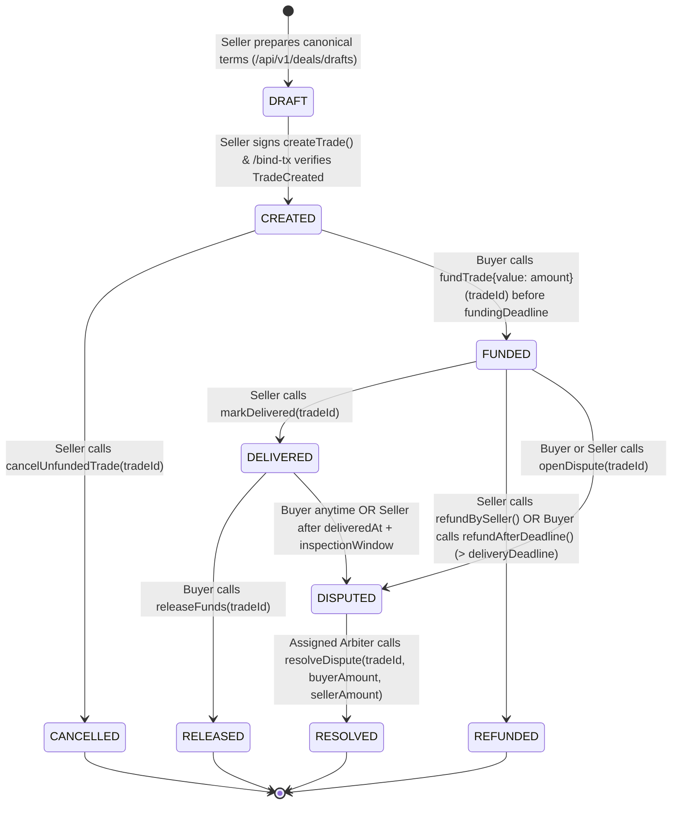

# Escrow & Dispute State Machines

## 1. Escrow State Machine Diagram

Off-chain database state (`DealStatus`) mirrors authoritative on-chain `SafeDealEscrow.TradeStatus`, adding pre-chain `DRAFT` authoring before `createTrade` is bound.

## 2. `DealStatus` Transition & Reconciliation Matrix

Implemented identically in [`SafeDealEscrow.sol`](../blockchain/src/SafeDealEscrow.sol) and [`DealStatus.java`](../backend/src/main/java/com/safedeal/domain/deal/DealStatus.java):

| Current State | Authorized Trigger | Next State | Settlement Credited? |
|---|---|---|---|
| `DRAFT` | Seller `createTrade()` + `/bind-tx` | `CREATED` | No |
| `CREATED` | Seller `cancelUnfundedTrade()` | `CANCELLED` | Terminal (`settled = true` on off-chain projection; zero locked balance) |
| `CREATED` | Buyer `fundTrade{value: amount}()` (before `fundingDeadline`) | `FUNDED` | No (`_totalLockedEscrow += amount`; binds open buyer if `buyer == address(0)`) |
| `FUNDED` | Seller `markDelivered()` | `DELIVERED` | No (`deliveredAt` stamped) |
| `FUNDED` | Seller `refundBySeller()` or Buyer `refundAfterDeadline()` (`now > deliveryDeadline`) | `REFUNDED` | Yes: `_claimableBalances[buyer] += amount`, `settled = true` |
| `FUNDED` | Buyer or Seller `openDispute()` | `DISPUTED` | No |
| `DELIVERED` | Buyer `releaseFunds()` | `RELEASED` | Yes: `_claimableBalances[seller] += amount`, `settled = true` |
| `DELIVERED` | Buyer (anytime) or Seller (`now > deliveredAt + inspectionWindow`) `openDispute()` | `DISPUTED` | No |
| `DISPUTED` | Arbiter `resolveDispute(tradeId, buyerAmount, sellerAmount)` (`sum == amount`) | `RESOLVED` | Yes: credits buyer & seller claimables, `settled = true` |

### Authoritative Catch-Up Reconciliation (`canReconcileTo`)

If multiple transactions confirm quickly on-chain before an intermediate UI `/sync` call completes (for example, `CREATED -> FUNDED -> DELIVERED`), `DealStatus.canReconcileTo(next)` validates forward graph reachability along legal `SafeDealEscrow` edges while strictly forbidding backwards transitions or transitions out of terminal settled states (`RELEASED`, `REFUNDED`, `RESOLVED`, `CANCELLED`).

## 3. `DisputeStatus` Lifecycle

| Status | Trigger | Mutable Evidence Uploads? |
|---|---|---|
| `OPEN` | Buyer or Seller invokes `/api/v1/deals/{tradeId}/disputes` after confirming on-chain `DISPUTED` state | Yes (Buyer & Seller only) |
| `RESOLVED` | Arbiter records verified `DisputeResolved` tx (`/arbitration/disputes/{id}/resolution`) or background `BlockchainEventIndexerService` indexes `DISPUTE_RESOLVED` | No (immutable read-only archive for Seller, Buyer, Arbiter) |
