# Hồ sơ Dự thi & Cẩm nang Triển lãm SEApp UIT — SafeDeal (Bảng App)

> **Cuộc thi:** **SEApp (SE APP)** — Ngày hội Triển lãm Ứng dụng & Sản phẩm Công nghệ Sinh viên  
> **Đơn vị tổ chức:** Khoa Công nghệ Phần mềm (*Faculty of Software Engineering* — `se.uit.edu.vn`), Trường Đại học Công nghệ Thông tin – ĐHQG TP.HCM (**UIT**)  
> **Bảng đăng ký:** **Bảng App** (*Web-based Application / Web3 FinTech DApp + Manifest V3 Chrome Extension Companion*)  
> **Địa điểm triển lãm:** **Sảnh Tầng 7, Tòa nhà E, Trường ĐH Công nghệ Thông tin (UIT)**

---

## 1. Bộ Nội dung Copy-Paste Đăng ký Google Form (Vòng Sơ loại SEApp UIT)

> [!IMPORTANT]
> Khi điền biểu mẫu đăng ký trực tuyến của Khoa CNPM (trên Fanpage **SeExpress** / cổng SEApp), nhóm bắt buộc đăng nhập bằng **email sinh viên UIT (`@gm.uit.edu.vn`)** và kiểm tra quyền truy cập công khai của GitHub Repo, Video Demo cùng các đường dẫn Live Deployment.

| Trường thông tin trên Form | Nội dung chuẩn bị sẵn (Copy & Paste) |
| :--- | :--- |
| **Tên sản phẩm / Đề tài** | **SafeDeal — Nền tảng Khế ước Ký quỹ P2P Phi Lưu Ký trên Avalanche C-Chain & Tiện ích Trình duyệt (Chrome Extension MV3)** |
| **Bảng dự thi** | **Bảng App** (Ứng dụng Web / Phần mềm thực tiễn & Tiện ích mở rộng trình duyệt) |
| **Thông tin Đội thi (1–6 SV UIT)** | `[Điền Họ tên - MSSV - Khoa CNPM / Khoa khác tại UIT - Email <mssv>@gm.uit.edu.vn]` |
| **Tóm tắt ngắn gọn (Elevator Pitch — 2 câu)** | SafeDeal giải quyết triệt để nghịch lý niềm tin trong giao dịch số P2P của sinh viên và freelancer Việt Nam (mua bán đồ công nghệ, nhận dự án freelance, trao đổi tài khoản/bản quyền phần mềm) bằng hợp đồng thông minh ký quỹ phi lưu ký (*non-custodial pull-payment escrow*) trên mạng Avalanche C-Chain. Hệ thống kết hợp định chuẩn điều khoản **RFC 8785 (`termsHash`)**, cơ chế đồng thuận phân xử **2-trên-3 (`submitResolutionVote`) + bảo hiểm chống kẹt tiền 14 ngày (`resolveDisputeByTimeout`)**, backend **Rust Axum Clean Architecture** và tiện ích **SafeDeal Escrow Companion (Chrome Extension Manifest V3)** giúp kiểm tra trạng thái ký quỹ on-chain ngay khi đang chat trên Facebook, Discord hay Chợ Tốt. |
| **Link Web App (Live Deployment)** | `https://avalanche-9b099.web.app/` |
| **Link Backend API Readiness Probe** | `https://safedeal-production.up.railway.app/api/v1/health/ready` |
| **Địa chỉ Smart Contract (Avalanche Fuji `43113`)** | `0xF30E863b0Cfe8fBFE05E65c21878F8B621B3FE29` ([Xem trên Snowtrace Explorer](https://testnet.snowtrace.io/address/0xF30E863b0Cfe8fBFE05E65c21878F8B621B3FE29)) |
| **Tiện ích Chrome Extension (Manifest V3)** | Thư mục `/extension` trong mã nguồn (`SafeDeal Escrow Companion — Avalanche P2P Verifier`, cài đặt qua `chrome://extensions` -> *Load unpacked*) |
| **Link Mã nguồn (GitHub Repository)** | `[Điền URL GitHub Repository công khai của nhóm]` |
| **Link Video Demo (1–3 phút)** | `[Điền link YouTube / Google Drive quay theo kịch bản Mục 3 bên dưới]` |

### Mô tả Chi tiết Bài toán, Giải pháp & Kiến trúc Kỹ thuật (Dùng cho ô Mô tả chi tiết trên Form)

1. **Bài toán thực tiễn tại Việt Nam & Môi trường Sinh viên UIT:**
   - Giao dịch P2P trực tuyến (freelance code/thiết kế UI-UX, mua bán laptop/giáo trình cũ, trao đổi tài khoản/license phần mềm trên Facebook Groups, Messenger, Discord, Telegram, Chợ Tốt) luôn đối mặt với **Nghịch lý Niềm tin**: Chuyển tiền trước thì người mua sợ bị lừa (*scam*); giao sản phẩm/source code trước thì người bán sợ bị "bùng tiền" (*ghosting*); dùng trung gian truyền thống (*middleman/admin group*) thì tốn phí cao, rủi ro bị đóng băng vốn hoặc trung gian ôm tiền bỏ trốn.
2. **Giải pháp Đột phá của SafeDeal:**
   - **Hợp đồng Thông minh Phi Lưu Ký (`SafeDealEscrow.sol` — Solidity `0.8.28`)**: Giữ tài sản trực tiếp trên Avalanche C-Chain, **không có khóa Admin/Owner/Pause/Sweep**. Áp dụng mô hình **Pull-Payment (`withdraw()`)** kết hợp `ReentrancyGuard` và `Checks-Effects-Interactions`, cô lập hoàn toàn tấn công Reentrancy và lỗi từ chối nhận tiền (*reverting-contract DoS*).
   - **Đồng thuận Trọng tài Đa phương 2-trên-3 (`submitResolutionVote`) & Fallback 14 Ngày (`resolveDisputeByTimeout`)**: Loại bỏ quyền lực tuyệt đối (*god-mode*) của một trọng tài đơn lẻ. Khi có tranh chấp (`DISPUTED`), chỉ cần **2 trong 3 bên (`Buyer`, `Seller`, `Arbiter`)** bỏ phiếu trùng khớp tỷ lệ chia tiền (`buyerAmount + sellerAmount == trade.amount`, phí trọng tài = `0`) là hợp đồng tự động tất toán. Nếu cả nhóm bế tắc hoặc mất liên lạc quá **14 ngày (`DISPUTE_TIMEOUT`)**, bất kỳ bên nào cũng có thể kích hoạt `resolveDisputeByTimeout` để chia tự động 50/50 — cam kết **0% nguy cơ kẹt tiền vĩnh viễn**.
   - **Cam kết Điều khoản Thương mại Xuyên tầng chuẩn RFC 8785 (`termsHash`)**: Toàn bộ điều khoản tiếng Việt/tiếng Anh được chuẩn hóa JSON theo **RFC 8785** và băm **SHA-256** đồng nhất từng byte giữa **React TypeScript (`canonical-terms.ts`)**, **Rust Backend (`canonical_terms.rs`)** và **Chrome Extension (`canonical-terms.js`)** trước khi neo lên blockchain.
   - **Kiến trúc Backend Rust Clean Architecture 5 Crates (`backend/`)**: Xây dựng bằng **Rust `1.91+` & Axum `0.8`** chia làm 5 crates (`shared`, `domain`, `application`, `infrastructure`, `presentation`) được kiểm tra tự động bằng test kiến trúc `architecture_dag.rs`. Mọi lệnh gọi JSON-RPC (`AlloyBlockchainGateway`) được tách hoàn toàn khỏi transaction PostgreSQL (`UnitOfWork::in_tx`), kết hợp xác thực **SIWE (EIP-4361)** nonce dùng một lần, phiên kép **`HttpOnly` JWT + Double-Submit CSRF + `Authorization: Bearer` fallback**, và kiểm증 bằng chứng tranh chấp bằng **chữ ký nhị phân Magic-Byte + kiểm tra toàn vẹn SHA-256** khi tải lên/tải xuống.
   - **Tiện ích Trình duyệt `SafeDeal Escrow Companion` (`extension/` — Chrome Extension Manifest V3)**: Cho phép kiểm tra trực tiếp trạng thái ký quỹ on-chain (`eth_call` `getTrade`) và đối chiếu mã băm điều khoản RFC 8785 ngay trong thanh **Side Panel**, tự động gắn nhãn xác thực (**Shadow DOM Badge**) cạnh các link `/deals/<tradeId>` trên trang web, và bôi đen văn bản thỏa thuận chuột phải để khởi tạo nhanh hợp đồng ký quỹ.

---

## 2. Thiết kế Poster / Standee Khổ A1 / A0 tại Sảnh Tầng 7 Tòa E UIT

> [!TIP]
> Tại vòng Triển lãm ở **Sảnh Tầng 7 Tòa E**, giám khảo giảng viên Khoa CNPM, chuyên gia doanh nghiệp (FPT Software, VNG...) và hàng trăm sinh viên sẽ đi dọc các gian hàng. Poster cần truyền tải được **Bài toán trong 3 giây**, **Hàm lượng kỹ thuật trong 15 giây**, và có **3 Mã QR lớn ở tầm mắt** để sinh viên quét trải nghiệm & bình chọn (chiếm **~20% tổng điểm chung cuộc**).

### Bố cục Chi tiết Poster (Layout 5 Khu vực Chuẩn Triển lãm SEApp)

```mermaid
flowchart TD
    subgraph HEADER["1. HEADER (12% chiều cao trên cùng)"]
        H1["Logo ĐHQG-HCM / UIT + Logo Khoa Công nghệ Phần mềm (SE) + Logo SEApp"]
        H2["SAFEDEAL — NỀN TẢNG ESCROW P2P PHI LƯU KÝ TRÊN AVALANCHE & CHROME EXTENSION MV3"]
        H3["Bảng App • Nhóm Sinh viên UIT • Mạng Avalanche Fuji C-Chain (43113)"]
    end

    subgraph PROBLEM_SOLUTION["2. BÀI TOÁN vs. GIẢI PHÁP SAFEDEAL (22% chiều cao)"]
        P1["❌ Giao dịch P2P Truyền thống:<br/>• Chuyển khoản trước -> Rủi ro bị Scam<br/>• Giao code/hàng trước -> Rủi ro bị Bùng tiền<br/>• Trung gian cá nhân -> Phí cao, rủi ro ôm tiền"]
        S1["✅ Giải pháp SafeDeal Web3 + Web2.5:<br/>• Khóa AVAX trong Smart Contract Phi Lưu Ký (0 Admin Key)<br/>• Neo điều khoản chuẩn RFC 8785 SHA-256 (termsHash)<br/>• Đồng thuận 2-trên-3 + Bảo hiểm chống kẹt vốn 14 ngày"]
        P1 --> S1
    end

    subgraph TECH_PILLARS["3. 4 ĐỘT PHÁ KỸ THUẬT DÀNH CHO HỘI ĐỒNG GIÁM KHẢO (32% chiều cao)"]
        T1["① Smart Contract Pull-Payment<br/>Solidity 0.8.28 + ReentrancyGuard<br/>2-of-3 submitResolutionVote<br/>14-Day resolveDisputeByTimeout<br/>Foundry 64x2,048 Invariant Fuzzing"]
        T2["② Rust Axum Clean Architecture<br/>5-Crate DAG (architecture_dag.rs)<br/>Non-Transactional Alloy RPC<br/>PostgreSQL 16 + SQLx (12 Tables)<br/>OpenAPI 3.0 Contract Parity"]
        T3["③ Bảo mật Đa tầng Web2.5<br/>SIWE EIP-4361 Single-Use Nonce<br/>HttpOnly JWT + CSRF + Bearer<br/>Bằng chứng Magic-Byte & SHA-256<br/>Strict HTTP 403 cho người ngoài"]
        T4["④ Chrome Extension MV3 & UX<br/>Side Panel On-Chain Deal Verifier<br/>RFC 8785 Hash Checker (Web Crypto)<br/>Shadow DOM Link Status Badge<br/>1-Click Mẫu Giao dịch Sinh viên UIT"]
    end

    subgraph VISUALS["4. SƠ ĐỒ KIẾN TRÚC & GIAO DIỆN THỰC TẾ (20% chiều cao)"]
        V1["Sơ đồ State Machine (CREATED -> FUNDED -> DELIVERED -> RELEASED / DISPUTED -> RESOLVED)"]
        V2["Ảnh chụp màn hình: Trang chủ Foldcraft + Trang Tạo Deal UIT + Chrome Extension Side Panel"]
    end

    subgraph QRCODES["5. CHÂN POSTER — 3 MÃ QR TƯƠNG TÁC TRỰC TIẾP (14% chiều cao dưới cùng)"]
        QR1["📱 QR 1: TRẢI NGHIỆM WEB APP<br/>https://avalanche-9b099.web.app/"]
        QR2["⛓️ QR 2: HỢP ĐỒNG SNOWTRACE<br/>0xF30E863b...621B3FE29"]
        QR3["🗳️ QR 3: BÌNH CHỌN SEAPP UIT<br/>[Link Form Bình chọn SeExpress]"]
    end

    HEADER --> PROBLEM_SOLUTION --> TECH_PILLARS --> VISUALS --> QRCODES
```

### Bảng Thông số Màu sắc & Typography Đề xuất khi Thiết kế Poster (Figma / Canva / Illustrator)
- **Nền chủ đạo (Background):** Dark Institutional Slate (`#090D16` -> `#0F172A`) đồng bộ 100% với giao diện Web App và Chrome Extension Side Panel.
- **Màu nhấn thương hiệu (Accent):** Emerald Trust (`#10B981` — trạng thái `FUNDED` / `VERIFIED`), Avalanche Crimson (`#E84142`), và Amber Warning (`#F59E0B` — trạng thái `DISPUTED`).
- **Font chữ:** Tiêu đề dùng `Inter` / `Be Vietnam Pro` Bold (hỗ trợ tiếng Việt sắc nét ở khổ in A1/A0); địa chỉ ví và mã băm dùng `JetBrains Mono`.

---

## 3. Kịch bản Thuyết trình & Live Demo 3 Phút tại Gian hàng (Booth Tầng 7 Tòa E)

### 3.1. Danh mục Chuẩn bị Thiết bị & Phương án Dự phòng Mạng (Dual-Environment Fail-Safe)

- [ ] **Laptop 1 — Môi trường Live Cloud + Avalanche Fuji Testnet (Chính):**
  - Kết nối qua **4G/5G Hotspot cá nhân** (tuyệt đối không phụ thuộc vào Wi-Fi công cộng đông người tại sảnh Tầng 7 Tòa E).
  - Mở sẵn 3 cửa sổ/profile Chrome đã nạp sẵn **10+ Fuji AVAX** cho mỗi ví:
    1. **Profile Seller (Người bán — Sinh viên Freelancer UIT)**
    2. **Profile Buyer (Người mua — Khách hàng / Sinh viên mua đồ)**
    3. **Profile Arbiter (Trọng tài công nghệ)**
  - Đã ghim tiện ích **`SafeDeal Escrow Companion` (`extension/`)** trên thanh công cụ Chrome và mở sẵn **Side Panel**.
- [ ] **Laptop 2 — Môi trường Offline Local Stack (Dự phòng Tức thời `<100ms` block time):**
  - Chạy sẵn `bash scripts/dev-db.sh`, `bash scripts/dev-anvil.sh`, `bash scripts/deploy-local.sh`, `bash scripts/dev-backend.sh`, `bash scripts/dev-frontend.sh` tại `http://localhost:5173`. Nếu sóng 4G tại tòa E bị nghẽn, chuyển sang Laptop 2 để demo full-stack ngay lập tức mà không cần Internet.
- [ ] **Cửa sổ VS Code mở sẵn 4 file để trả lời phản biện kỹ thuật của Giảng viên:**
  1. [`blockchain/src/SafeDealEscrow.sol`](../blockchain/src/SafeDealEscrow.sol) (Hàm `submitResolutionVote`, `resolveDisputeByTimeout`, `withdraw`).
  2. [`backend/tests/architecture_dag.rs`](../backend/tests/architecture_dag.rs) (Kiểm chứng Clean Architecture DAG 5 crates Rust).
  3. [`backend/crates/application/src/disputes.rs`](../backend/crates/application/src/disputes.rs) (Xác thực bằng chứng Magic-Byte & SHA-256).
  4. [`extension/manifest.json`](../extension/manifest.json) & [`extension/sidepanel/sidepanel.js`](../extension/sidepanel/sidepanel.js) (Kiến trúc Chrome Extension Manifest V3).

---

### 3.2. Kịch bản Pitching 3 Phút (Dành cho Hội đồng Ban Giám khảo Khoa CNPM & Doanh nghiệp)

#### ⏱️ [0:00 – 0:30] Mở đầu (Hook) — Bài toán Thực tế & Kiến trúc Không Lưu Ký
- **Thao tác trên màn hình:** Hiển thị trang chủ [`https://avalanche-9b099.web.app/`](https://avalanche-9b099.web.app/) kèm thanh **SafeDeal Escrow Companion Side Panel** bên phải.
- **Lời thuyết trình (Tiếng Việt):**
  > *"Em chào Thầy/Cô và các anh/chị Giám khảo ạ! Khi sinh viên UIT nhận làm đồ án freelance, mua bán laptop cũ hay trao đổi tài khoản phần mềm trên mạng, luôn có một câu hỏi không ai muốn nhường ai: **Ai chuyển tiền trước? Ai giao code trước?** Chuyển tiền trước thì sợ bị scam, giao code trước thì sợ bị bùng, mà nhờ admin trung gian thì tốn phí và rủi ro trung gian ôm tiền. Đó là lý do nhóm em xây dựng **SafeDeal** — nền tảng khế ước ký quỹ P2P phi lưu ký trên mạng **Avalanche C-Chain**, kết hợp Backend **Rust Clean Architecture** và tiện ích **Chrome Extension Manifest V3**."*

#### ⏱️ [0:30 – 1:25] Luồng 1 — Tạo Giao dịch 1-Click Sinh viên UIT, Định chuẩn RFC 8785 & Ký quỹ Pull-Payment
- **Thao tác trên màn hình:**
  1. Chuyển sang tab `/create` (Profile **Seller**). Nhấn nút mẫu **"Freelance Đồ án / Thiết kế UI-UX"** (1-Click SEApp UIT Template) để điền tức thì điều khoản thương mại.
  2. Nhấn **Preview** để chỉ cho BGK thấy mã băm `termsHash` chuẩn **RFC 8785** khớp tuyệt đối giữa trình duyệt và Rust Backend, sau đó bấm **Create Trade On-Chain** (`createTrade`).
  3. Copy `tradeId` dán ngay vào **Chrome Extension Side Panel** (Tab *Verify Deal*) để hiển thị trạng thái trực tiếp từ Avalanche Fuji RPC mà không cần đăng nhập ví.
  4. Chuyển sang Profile **Buyer**: Nhấn **Fund Escrow** (`fundTrade`) -> Seller nhấn **Mark Delivered** (`markDelivered`) -> Buyer nhấn **Release Funds** (`releaseFunds`) -> Seller rút tiền về ví qua **Withdraw Balance** (`withdraw()`).
- **Lời thuyết trình:**
  > *"Tại trang tạo giao dịch, nhóm em tích hợp sẵn các mẫu giao dịch thực tế của sinh viên UIT. Khi tạo deal, toàn bộ điều khoản được chuẩn hóa theo **RFC 8785 Canonical JSON** và băm SHA-256 đồng nhất giữa TypeScript, Rust và Chrome Extension rồi lưu bất biến lên Avalanche. Đặc biệt, với tiện ích **SafeDeal Companion trên Chrome Side Panel**, bất kỳ ai nhận được link giao dịch trên Messenger hay Discord đều có thể kiểm tra trực tiếp trạng thái tiền đã khóa trong Smart Contract hay chưa thông qua `eth_call` mà không cần kết nối ví. Khi hoàn tất, tiền được rút theo cơ chế **Pull-Payment (`withdraw()`)**, triệt tiêu hoàn toàn lỗi Reentrancy và DoS."*

#### ⏱️ [1:25 – 2:25] Luồng 2 — Tranh chấp, Bằng chứng Riêng tư Magic-Byte & Đồng thuận 2-trên-3 + Bảo hiểm 14 Ngày
- **Thao tác trên màn hình:**
  1. Mở một giao dịch đang ở trạng thái `DISPUTED` (`/disputes/:id`).
  2. Tải lên 1 file ảnh bằng chứng PNG và nhấn nút **Download** (sử dụng `downloadAuthenticatedAttachment` xác thực `Bearer` + kiểm tra toàn vẹn SHA-256). Mở nhanh cửa sổ ví **Outsider (Người lạ)** để chứng minh hệ thống trả về lỗi `403 Access Denied`.
  3. Mở `/arbiter` (**DisputeConsensusPanel**): Trọng tài bỏ phiếu chia tỷ lệ (`submitResolutionVote`), sau đó Buyer (hoặc Seller) bỏ phiếu đồng thuận **2-trên-3** để giải ngân tức thì. Chỉ vào đồng hồ đếm ngược **14-Day Stalemate Fallback (`resolveDisputeByTimeout`)**.
- **Lời thuyết trình:**
  > *"Điểm khác biệt lớn nhất của SafeDeal nằm ở cơ chế xử lý tranh chấp. Thứ nhất, mọi tệp bằng chứng tải lên đều được Rust Backend kiểm tra chữ ký nhị phân **Magic-Byte** và đối chiếu mã băm **SHA-256** cả khi lưu lẫn khi tải xuống; người ngoài truy cập sẽ bị chặn đứng với mã `403`. Thứ hai, thay vì để một trọng tài có quyền lực tuyệt đối dễ dẫn tới thông đồng, SafeDeal yêu cầu **đồng thuận 2-trên-3 (`submitResolutionVote`)** giữa Người mua, Người bán và Trọng tài. Và nếu xảy ra trường hợp xấu nhất là hai bên mất liên lạc hoàn toàn? Sau **14 ngày**, hàm `resolveDisputeByTimeout` cho phép tự động chia 50/50 ngay trên chuỗi — đảm bảo không một đồng AVAX nào bị kẹt lại hợp đồng."*

#### ⏱️ [2:25 – 3:00] Tổng kết Kỹ thuật (Engineering Quality Gate) & Mời Phản biện
- **Thao tác trên màn hình:** Chiếu nhanh Terminal đã chạy xanh toàn bộ bộ kiểm thử (`20/20` Foundry tests + `64 x 2,048` stateful invariant calls, `cargo test` Clean Architecture DAG, Vitest + Playwright E2E, và `node extension/verify-extension.mjs`).
- **Lời thuyết trình:**
  > *"Về độ hoàn thiện kỹ thuật, toàn bộ hệ thống đã được kiểm chứng tự động: Smart Contract vượt qua **2.048 bước kiểm thử bất biến trạng thái (Stateful Invariant Fuzzing)** với 0 cảnh báo trình biên dịch; Backend Rust tuân thủ nghiêm ngặt Clean Architecture 5 crates không giữ kết nối Database khi gọi RPC; và toàn bộ ứng dụng đang chạy thực tế trên **Firebase Hosting**, **Railway** và **Avalanche Fuji**. Nhóm em rất mong nhận được câu hỏi phản biện từ Thầy/Cô và Hội đồng Giám khảo ạ!"*

---

### 3.3. Kịch bản Vòng lặp 60 Giây Thu hút Sinh viên Bình chọn tại Gian hàng (Tối ưu 20% Điểm Bình chọn Cộng đồng)

1. **Bước 1 (15 giây — Trải nghiệm Bôi đen Văn bản tạo Ký quỹ):** Mời bạn sinh viên ghé booth bôi đen một đoạn tin nhắn thỏa thuận mua bán mẫu trên màn hình -> Click chuột phải chọn **"Draft SafeDeal Escrow from Selection"** -> Xem thông báo Toast Shadow DOM bật lên và thanh Chrome Side Panel tự động tính mã băm chuẩn **RFC 8785**.
2. **Bước 2 (25 giây — Tự tay Bấm Giải ngân On-Chain):** Mời bạn sinh viên bấm nút **"Approve & Release Funds"** hoặc bỏ phiếu **"Submit Resolution Vote (2-of-3)"** trên giao dịch mẫu đã nạp sẵn Fuji AVAX để thấy giao dịch xác nhận trên Avalanche trong ~2 giây.
3. **Bước 3 (20 giây — Quét QR Bình chọn):** Mời bạn sinh viên quét **Mã QR số 3** ở chân Poster để bình chọn cho **SafeDeal (Bảng App)** trên biểu mẫu bình chọn của Ban Tổ chức SEApp UIT và tương tác bài đăng trên Fanpage **SeExpress**.

---

## 4. Đối chiếu Ma trận Tiêu chí Chấm điểm SEApp UIT & Minh chứng trong Mã nguồn

| Tiêu chí Chấm điểm Chính thức (SEApp UIT) | Điểm mạnh Cốt lõi của SafeDeal | Minh chứng Kiểm thử & File Tham chiếu |
| :--- | :--- | :--- |
| **1. Tính khoa học & Giá trị thực tiễn** | Giải quyết bài toán lừa đảo giao dịch số P2P bằng Smart Contract Pull-Payment phi lưu ký, đồng thuận 2-trên-3 + timeout 14 ngày, và chuẩn hóa điều khoản RFC 8785 xuyên suốt 3 môi trường (Rust, React, Chrome Extension). | [`blockchain/src/SafeDealEscrow.sol`](../blockchain/src/SafeDealEscrow.sol), [`backend/crates/domain/src/canonical_terms.rs`](../backend/crates/domain/src/canonical_terms.rs), [`extension/shared/canonical-terms.js`](../extension/shared/canonical-terms.js) |
| **2. Tính hoàn thiện & Ổn định kỹ thuật** | Kiến trúc Rust Clean Architecture 5 crates (`architecture_dag.rs`), tách biệt hoàn toàn RPC khỏi DB transaction (`UnitOfWork::in_tx`), tự động đồng bộ sự kiện on-chain (`BlockchainEventIndexerService`), kiểm tra toàn vẹn bằng chứng SHA-256, và khôi phục giao dịch khi tải lại trang (`/create`). | [`backend/tests/architecture_dag.rs`](../backend/tests/architecture_dag.rs), [`blockchain/test/EscrowInvariant.t.sol`](../blockchain/test/EscrowInvariant.t.sol), [`scripts/verify.sh`](../scripts/verify.sh), [`scripts/e2e-live.sh`](../scripts/e2e-live.sh) |
| **3. Trải nghiệm & Giao diện Người dùng (UX/UI)** | Giao diện Foldcraft hiện đại, 1-Click mẫu giao dịch sinh viên UIT, tự động thêm mạng Avalanche Fuji (`wallet_addEthereumChain` khi gặp mã `4902`), cảnh báo ví 0 AVAX kèm link Faucet, phân trang Dashboard, và tiện ích Chrome Side Panel kiểm tra deal không cần đăng nhập ví. | [`frontend/src/pages/CreateDealPage.tsx`](../frontend/src/pages/CreateDealPage.tsx), [`frontend/src/pages/DisputePage.tsx`](../frontend/src/pages/DisputePage.tsx), [`extension/sidepanel/sidepanel.html`](../extension/sidepanel/sidepanel.html) |
| **4. Kỹ năng Thuyết trình, Demo & Phản biện** | Đầy đủ kịch bản demo 3 phút, bộ câu hỏi phản biện chuyên sâu (9 câu hỏi bao gồm cả Lý thuyết Trò chơi 14-day timeout và kiến trúc Chrome Extension MV3), cùng Poster chuẩn triển lãm Tầng 7 Tòa E. | [`docs/demo/demo-script.md`](./demo/demo-script.md), [`docs/demo/judge-qa.md`](./demo/judge-qa.md), [`docs/17-seapp-uit-submission.md`](./17-seapp-uit-submission.md) |
